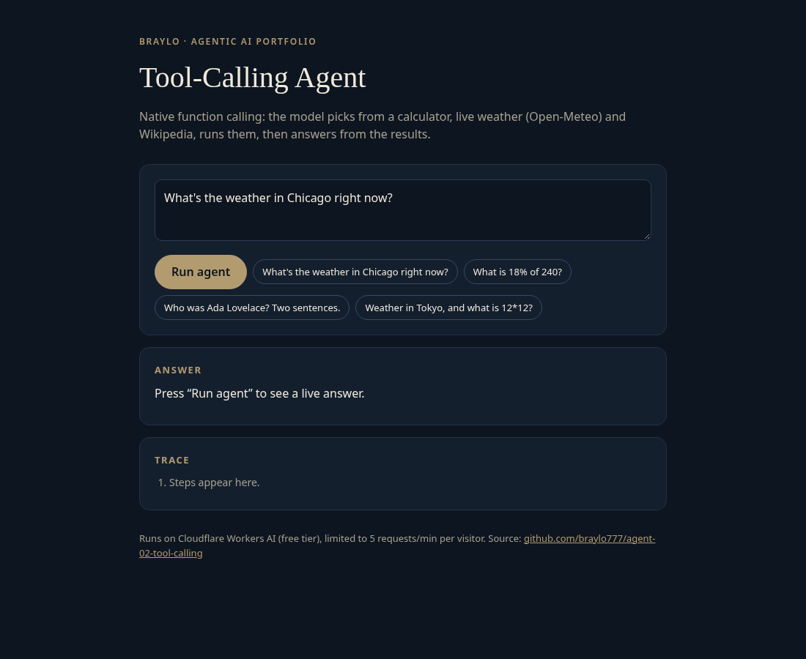
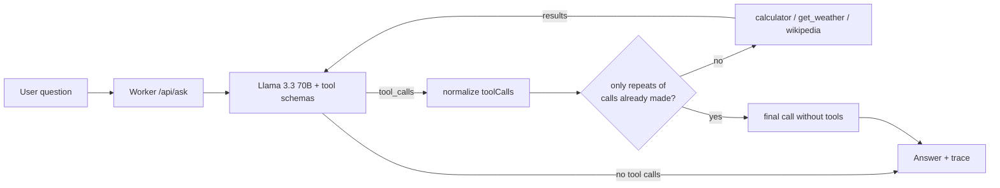

# Tool-Calling Agent

An agent that uses native JSON-schema function calling to choose real tools (calculator, live weather from Open-Meteo, Wikipedia), runs them, and answers from the results. Runs serverless on Cloudflare Workers with the free Workers AI tier. Project 2 of a 10-part agentic AI portfolio by Braylo.

**Live demo:** https://agent-02-tool-calling.braylo777.workers.dev



## Architecture


## How it works
1. Three tools are declared as JSON schemas and sent with each model call.
2. `toolCalls()` normalizes native `tool_calls` and the JSON-in-text format Llama sometimes emits.
3. The Worker runs the calls (Open-Meteo geocoding + forecast, Wikipedia REST summary, safe arithmetic parser) and feeds results back.
4. Loop guard: if the model only repeats calls it already made, the agent asks once more without tools and returns that answer.
5. Up to 4 rounds; the response includes every tool, its arguments and its result.

- `src/agent.js`: tool schemas, implementations, call normalizer and loop
- `src/calc.js`: safe arithmetic parser
- `src/core.js`: Workers AI, rate-limit and JSON helpers
- `src/index.js`, `src/page.html`: routes and demo UI

Guardrails: 5 requests/min per IP (Workers Rate Limiting), 500-character input cap, errors returned as JSON.

## Evaluation (live model)
[`evals/run.mjs`](evals/run.mjs) sends every case in [`evals/cases.json`](evals/cases.json) to the **deployed** demo (Llama 3.3 70B fp8 on Workers AI) and scores it. A case passes when the response is HTTP 200, the answer contains the expected key fact(s) (case-insensitive), and the set of tools used equals the expected set (empty for questions that need no tool). Latency is end-to-end HTTP from the eval machine. The suite is deliberately small to stay inside the free daily Workers AI allowance, so treat the numbers as indicative.

**Full run, 16 cases, before the eval-driven fixes** ([`evals/results.json`](evals/results.json), 2026-10-28T00:23:25.659Z):

| Metric | Value |
|---|---|
| Pass rate (answer correct and right tools) | 75.0% (12/16) |
| Answer accuracy | 81.2% (13/16) |
| Tool-selection accuracy (set of tools used = expected set) | 93.8% (15/16) |
| Latency p50 / p95 (end-to-end HTTP) | 2155 ms / 5570 ms |

**Re-run after the fixes, partial: 9 cases** ([`evals/results.postfix-partial.json`](evals/results.postfix-partial.json)): 9/9 passed; the same 9 cases passed 8/9 before the fixes. The re-run stopped early when the build machine was restored, and the shared free Workers AI daily allowance ran out before a full re-run, so the post-fix numbers cover only these cases. `node evals/run.mjs` reproduces the full suite.

Failures in the full (pre-fix) run:
- `p01` Use Wikipedia: who was Ada Lovelace? → tools ['wikipedia', 'wikipedia', 'wikipedia', 'wikipedia']: Step limit reached.
- `x02` Get the temperature in London and compute 365*24. → tools ['get_weather', 'calculator', 'calculator', 'calculator']: Step limit reached.
- `n01` Say hello in French. → tools []: I am unable to fulfill this request as the functions provided are insufficient.
- `n02` What is the opposite of 'hot'? → tools ['wikipedia']: The opposite of "hot" is "cold".

**What the evals caught:** The first full run showed the model re-calling the same tool with identical arguments until the step limit (`p01`, `x02`), refusing a greeting because "the functions are insufficient" (`n01`), and calling Wikipedia for a trivial question (`n02`). A repeat-call guard and a clearer system prompt address these, with a regression test. Calculator output is also trimmed of float noise (0.18*240 → 43.2).

## Tests
15 offline unit tests (`node --test`), 15 passing. The LLM and HTTP APIs are mocked, so they run without a Cloudflare account.

## Run it
```bash
npm install
npm test                    # unit tests, Node 20+
npx wrangler dev            # local dev; Workers AI uses your Cloudflare login
npx wrangler deploy         # free tier, no paid API keys
node evals/run.mjs          # live eval against the demo (paced for the rate limit)
```

## License
MIT
